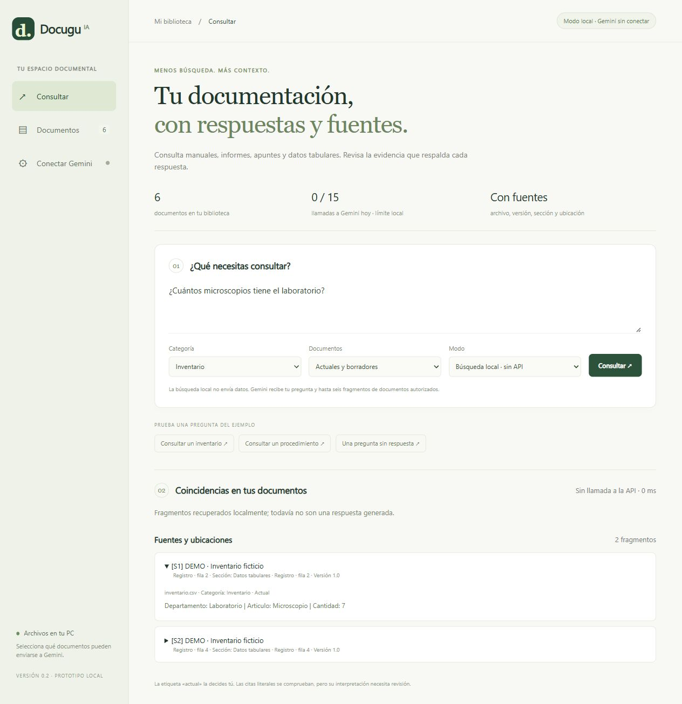
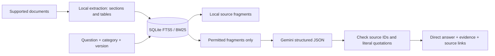
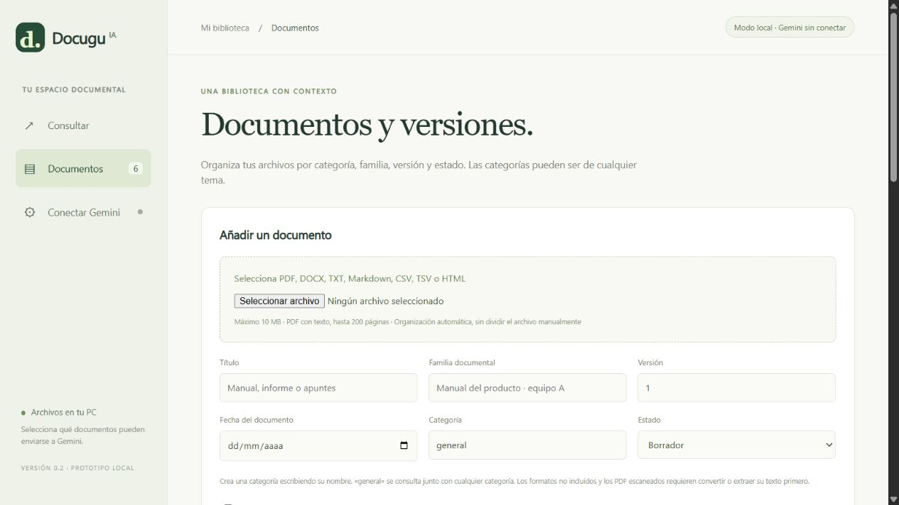

# DocuguIA

**Ask questions about your documents and inspect the sources behind each answer.**

[Español](docs/GUIA_ES.md) · [Architecture](docs/ARCHITECTURE.md) · [API](docs/API.md) · [Validation](docs/VALIDACION.md)



A local document assistant built with **Python, FastAPI, SQLite FTS5/BM25 and Gemini**. Organize manuals, reports, study notes, procedures and tabular records by your own categories. Search without an API, or generate short answers with source identifiers and quotations checked against the retrieved text. The interface is in Spanish.

## Features

- Custom categories, document families, versions and draft/current/historical states.
- Local retrieval without an API; optional Gemini generation with permission per document.
- Direct answer first, expandable evidence, section/location references and PDF page links.
- Table rows retain their column labels, including merged Word headers and cells.
- Local Word-to-PDF references with LibreOffice; ambiguous pages stay unverified.
- Local key storage, request budget, response cache and no automatic paid-model fallback.
- Fictional examples across operations, inventory and infrastructure; offline tests and CI.

## Supported formats

| Format | What is extracted |
| --- | --- |
| PDF | Selectable text, file page order, detected headings and bordered tables |
| DOCX | Paragraphs, heading hierarchy, labeled table rows; optional local PDF page links |
| TXT / Markdown | UTF-8 text, paragraphs and detected headings |
| CSV / TSV | UTF-8 records, first-row column labels and logical record locations |
| HTML / HTM | Uploaded local text, headings and simple tables; scripts/styles ignored |

General purpose refers to the subject matter, not every file format. Scans and images need OCR first. Legacy DOC, XLSX, presentations and audio/video are not parsed: export relevant content to a supported format. Complex layouts require checking the original. Limits: **10 MB per file, 200 PDF pages and one million extracted characters**.

## Run from a clone

Requires **Python 3.12+**. Local search needs no API key, frontend build or vector database.

```sh
git clone https://github.com/Andres-Vallejo/docuguia.git
cd docuguia
python -m venv .venv
```

Windows PowerShell:

```powershell
.\.venv\Scripts\python.exe -m pip install -e .
.\.venv\Scripts\python.exe -m uvicorn app.main:app --host 127.0.0.1 --port 8765 --no-access-log
```

Linux/macOS:

```sh
.venv/bin/python -m pip install -e .
.venv/bin/python -m uvicorn app.main:app --host 127.0.0.1 --port 8765 --no-access-log
```

Alternatively run `./start.ps1` in PowerShell or `sh start.sh` on Linux/macOS. Keep the repository checkout: demo assets are loaded from `demo/`. The lock files record the validated Python environment; `pyproject.toml` declares the direct dependencies.

Open [DocuguIA](http://127.0.0.1:8765), click **Cargar ejemplo**, then ask:

- “¿Cuántos microscopios tiene el laboratorio?” — inspect a labeled CSV row.
- “¿Cuánto tiempo se conservan las copias de seguridad de Atlas?” — inspect an operations guide.
- “¿Qué pruebas de aceptación se exigen para la red inalámbrica?” — compare document versions.

The six demo documents are completely fictional. No work documents or private data are included.

## Optional Gemini setup

1. Create a key in [Google AI Studio](https://aistudio.google.com/api-keys).
2. Verify that its project is on the **Free** tier without active billing. Some projects require verification.
3. Save the key in **Conectar Gemini** in the local UI. Never paste it into a chat or commit it.
4. Enable cloud permission only for documents you may share, then select **Respuesta con Gemini**.

The app sends the question and up to six retrieved fragments, not the original file. The free tier may use submitted content to improve Google's products. Availability and quotas vary by project; review [current pricing](https://ai.google.dev/gemini-api/docs/pricing) and [rate limits](https://ai.google.dev/gemini-api/docs/rate-limits). A local call limit cannot verify your billing tier or guarantee no charges on a paid account.

LibreOffice is optional and runs locally to generate Word reference PDFs. Page numbers refer to that copy and can differ from Word. Without it, section, paragraph and table references remain available.

## How it works



Prose chunks are bounded to 1,500 characters with a 180-character overlap for long units. Retrieval is lexical: synonyms and broad questions can be missed. There are no embeddings, reranker, OCR or autonomous tools. A selected category includes shared `general` documents. See [architecture and tradeoffs](docs/ARCHITECTURE.md).

## Validation

```sh
python -m pip install -e ".[dev]"
python -m pytest -q
python -m evaluation.run
```

Use the activated environment or its Python executable. Tests use synthetic documents and mocked providers, never a real key. CI runs on Windows and Ubuntu. Evaluation reports **10 synthetic retrieval checks** and **3 pending live-generation cases** separately. These development checks are not an independent benchmark or a measure of general answer accuracy.

Quotation validation confirms source identity and an exact substring. **It does not prove that the quote supports the generated claim.** Review quantities, scope and conflicts in the original. See [evaluation plan](docs/EVALUACION.md) and [observed validation](docs/VALIDACION.md).

## Project structure

```text
app/          FastAPI, extraction, retrieval, generation and static UI
demo/         Fictional documents for safe demonstrations
tests/        Offline regression tests
evaluation/   Isolated retrieval cases and recorded results
docs/         Architecture, API, Spanish guide and validation
.github/      Windows/Ubuntu CI
```

Local state is in ignored `data/`: SQLite, originals, reference PDFs and answer caches. The key is in ignored `.env`. Deleting a document clears its current saved files and the answer cache; separate backups and content already sent to Google are not removed. This single-user prototype has no multi-user authentication: bind it to localhost. See [data handling](SECURITY.md).

<details>
<summary>Document library and custom categories</summary>



</details>

A `Dockerfile` is included; build with `docker build -t docuguia .` and bind locally with `docker run --rm -p 127.0.0.1:8765:8765 -v docuguia-data:/app/data docuguia`. It omits LibreOffice, so Word keeps paragraph/table references. **Docker has not been executed in the author's environment.**

## Next improvements

- Reserve held-out paraphrase, contradiction and unanswerable questions before tuning retrieval.
- Compare lexical retrieval against a local embedding baseline.
- Add OCR and more formats with measured extraction coverage.
- Improve difficult tables and semantic citation evaluation.

These are planned, not current features. [Contributing](CONTRIBUTING.md) · [Changelog](CHANGELOG.md) · [Learning walkthrough](docs/APRENDER.md).

## Credits and license

**Juan Andrés Vallejo Rozo** — problem definition, use-case design, iterative testing and project direction. Implementation and documentation developed with **Codex** assistance. Fictional examples were created for this repository; no employer or institution endorses the project.

Conceptual references: [RAG From Scratch](https://github.com/langchain-ai/rag-from-scratch), [Gemini structured output](https://ai.google.dev/gemini-api/docs/structured-output), [FastAPI](https://fastapi.tiangolo.com/) and [pdfplumber](https://github.com/jsvine/pdfplumber). Independent implementation; third-party dependencies retain their respective licenses. Code and original examples: [MIT](LICENSE).
