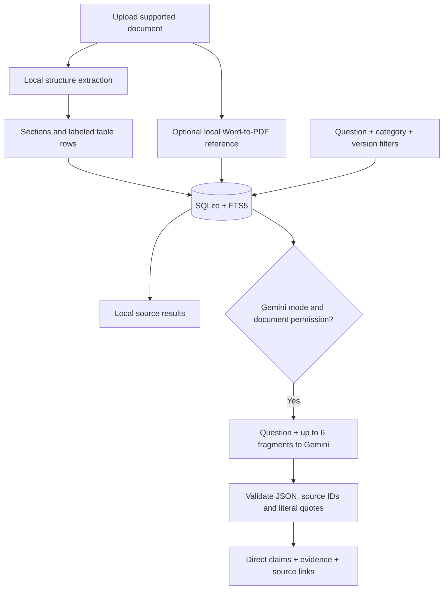

# Architecture

## Request flow

1. A local FastAPI endpoint accepts a supported file and user metadata.
2. Extraction produces units with text, section, location and type. Table records retain column labels. Adjacent prose is grouped up to 1,500 characters within the same section; long units overlap by 180 characters.
3. SQLite stores document metadata and chunks. FTS5 ranks matches with BM25 after category, version and cloud-permission filters. A selected category also includes shared `general` documents.
4. Local mode returns up to six source fragments without a model request.
5. Gemini mode sends only permitted retrieved fragments and the question. Structured JSON contains short claims, source identifiers and exact quotations.
6. Validation rejects unknown source identifiers, missing/invalid quotes and malformed outputs. Valid claims display first, with expandable evidence and source locations.

## Module map

| Module | Responsibility |
| --- | --- |
| `app/structure.py` | Word/PDF structure, section paths and table row relationships |
| `app/ingest.py` | Format dispatch, limits and bounded chunks |
| `app/rendering.py` | Local reference PDFs and conservative page lookup |
| `app/store.py` | Additive schema migrations, retrieval, filters, cache and call budget |
| `app/qa.py` | Gemini request, structured output, provenance and quotation validation |
| `app/config.py` | Local configuration, key persistence and model allowlist |
| `app/main.py` | Local HTTP endpoints, upload metadata and document lifecycle |
| `app/static/` | Spanish UI without a frontend build step |
| `tests/` | Synthetic regression fixtures; no provider calls |
| `evaluation/` | Isolated retrieval smoke evaluation and pending live cases |

## Scope and tradeoffs

Lexical retrieval keeps installation and search local and inexpensive, but can miss paraphrases. There are no embeddings, reranker, OCR, cross-document numerical aggregation engine or autonomous tools. Headings and table structures are extracted heuristically and should be inspected on complex layouts. Citation matching establishes provenance and a literal substring, not semantic entailment.

Word does not have stable page numbers in its XML. Page references therefore point to a locally rendered PDF; if matching is ambiguous the page remains unknown. PDF page numbers refer to the file's page order, which may differ from printed page labels.

The API retains `block` as the category field for compatibility with the original infrastructure prototype. Categories are now arbitrary user-supplied names. Existing databases keep their numeric category values and cloud permissions.
